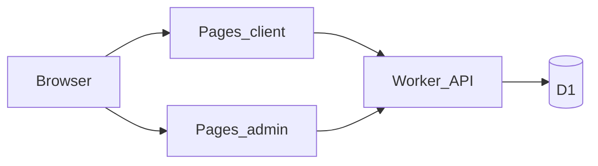

# UrbanCart

Premium men's accessories store on **Cloudflare Workers + D1 + Pages**. Black & gold luxury theme, Cash on Delivery, separate storefront and admin apps.

## Live URLs (fazlulkarim362@gmail.com)

| App | URL |
|-----|-----|
| Store | https://urbancart-7he.pages.dev |
| Admin | https://urbancart-admin.pages.dev |
| API | https://urbancart-api.fazlulkarim362.workers.dev |

Admin login: `admin@urbancart.com` / `Admin@UrbanCart2024!`  
Demo user: `demo@urbancart.com` / `Demo@123`

## Architecture

```
client/   → Cloudflare Pages  (store SPA)
admin/    → Cloudflare Pages  (admin SPA)
worker/   → Cloudflare Worker + D1 (REST API)
```

| Layer | Tech |
|-------|------|
| Storefront | React (Vite) → Cloudflare Pages |
| Admin | React (Vite) → Cloudflare Pages |
| API | Hono on Cloudflare Workers |
| Database | Cloudflare D1 (SQLite) |
| Auth | JWT (`jose`) + PBKDF2 password hashing |



## Local setup

```bash
# Install
npm run install:all

# Apply D1 schema (local)
cd worker && npx wrangler d1 migrations apply urbancart --local

# Start API (port 8787)
npm run dev:api

# Seed demo data (API must be running; ALLOW_SEED=true in worker/.dev.vars)
curl -X POST http://localhost:8787/api/dev/seed

# Start frontends (proxy /api → :8787)
npm run dev:client   # http://localhost:5173
npm run dev:admin    # http://localhost:5174
```

## Credentials

| App | Email | Password |
|-----|-------|----------|
| Admin | `admin@urbancart.com` | `Admin@UrbanCart2024!` |
| Demo user | `demo@urbancart.com` | `Demo@123` |

Secrets live in `worker/.dev.vars` (local) and `wrangler secret put` (production).

## Deploy

```bash
# API
cd worker && npx wrangler deploy

# Frontends (builds with production API URL)
VITE_API_URL=https://urbancart-api.fazlulkarim362.workers.dev/api npm run build --prefix client
VITE_API_URL=https://urbancart-api.fazlulkarim362.workers.dev/api npm run build --prefix admin
npm run deploy:client
npm run deploy:admin
```

## Features

### Storefront
- Premium home page (hero carousel, categories, featured products, reviews, contact)
- Product listing with filters, search, sort, pagination
- Product details with gallery zoom, lightbox, reviews, related products
- Cart + COD checkout (login required)
- User dashboard (profile, orders, status tracking)

### Admin
- Dashboard with stats & charts
- Product / category CRUD (Cloudinary-ready image URLs)
- Order management & status workflow
- Review moderation (hide / delete)
- User management (ban / delete)

## Brand

- **Name:** UrbanCart  
- **Logo:** UC mark  
- **Colors:** Black `#111111` · Gold `#C9A227` · White  
